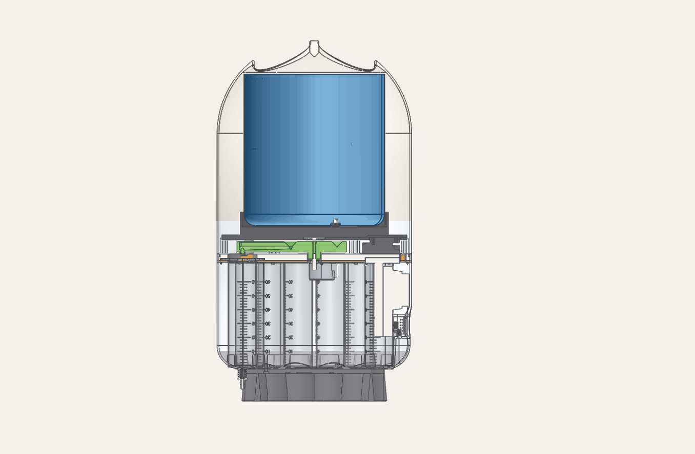
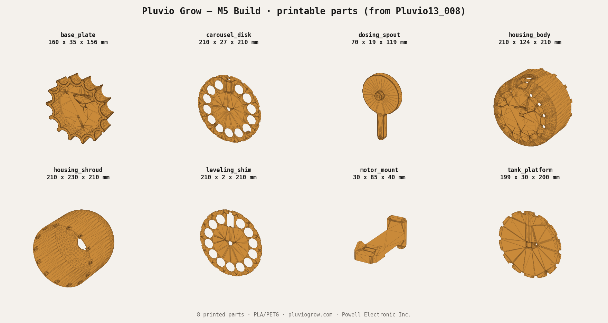

# Build a 13-Plant Self-Watering Robot (Open Source) — Pluvio Grow M5

## Intro

I kept killing my plants — so I built a little robot that waters 13 of them, each
its own exact amount, measured **by weight**. One arm spins around a carousel,
stops at each plant, and doses it from a single reservoir. It runs fully offline
on a tiny ESP32, and I made the whole thing source-available so you can build your own.

**What makes it different from a $40 drip timer:** it *weighs* every pour with a
load cell, so the cactus gets 15 g and the fern gets 60 g — not "everything for
30 seconds." Rain, with a brain.

- **Difficulty:** intermediate (soldering/crimping, a stepper tweak, 3D printing)
- **Time:** a weekend
- **Cost:** ~**$80–120** in parts for one build (per-unit prices); budget closer to
  ~**$200–265** at checkout once minimum-order packs and bulk tubing are counted — you'll have spares

---

## Supplies

### Electronics (DigiKey)

| Part | MPN | Qty | Unit |
|---|---|---:|---:|
| M5Stack **AtomS3R** dev kit (ESP32-S3 + 0.85″ display) | C126 | 1 | $17.50 |
| M5Stack **Mini Scales Unit** (HX711 load cell) | U177 | 1 | $6.95 |
| M5Stack **Atomic Motion Base** v1.2 (stepper + servo driver) | A090-V12 | 1 | $8.50 |
| **Olimex SM-5VDC** stepper (5-wire; convert to 4-wire **bipolar** — see note) | SM-5VDC | 1 | $1.76 |
| **AS5600** magnetic rotary encoder (arm position) | [AliExpress](https://www.aliexpress.com/item/1005008249897817.html) | 1 | — |
| **Diametric magnet, 6 × 2.5 mm** (AS5600 target — presses into the dosing spout on the motor shaft) | generic (AliExpress) | 1 | — |
| 5 V 5 W wall adapter | PSA05A-050QL6-H | 1 | $3.91 |
| USB-A → USB-C cable | DH-20M50053 | 1 | $1.92 |
| Connector housing, 2-pos 2.54 mm | M20-1060200 | 2 | $0.10 |
| Crimp socket, 22–30 AWG gold | M20-1180042 | 2 | $0.09 |

> **Heads-up on DigiKey min-order:** several of these have minimum quantities
> (e.g. the stepper and adapter ship in packs), so your cart total will exceed
> the per-unit cost above. Buy one device's worth; you'll have spares.

### Mechanical & plumbing

| Part | Source | Notes |
|---|---|---|
| Solenoid valve, 5 V | [AliExpress](https://www.aliexpress.com/item/1005005744031305.html) | the dosing valve |
| Solenoid driver (RC-PWM → DC) | [AliExpress](https://www.aliexpress.com/item/1005009888337481.html) | lets the Atomic Motion servo channel switch the valve |
| **60 mL Luer-lock syringe** ×13 | generic (AliExpress / Amazon) | per-plant carousel vessels |
| **Luer-lock → 1/4″ tube adapter** ×13 | generic | connects the tube to each syringe |
| Silicone tubing, 1/8″ ID × 1/4″ OD, soft 50A | [McMaster 51135K16](https://www.mcmaster.com/catalog/51135K16) | one run per plant; ≈6 ft each, ~78 ft total for 13 — measure your layout and buy in bulk |
| 1-gallon utility jug | [Uline S-10746B](https://www.uline.ca/Product/Detail/S-10746B/Jugs/Utility-Jugs-Bulk-Pack-1-Gallon-Natural) | reservoir |
| Top-hat rubber grommets (6 mm hole / 4 mm ID) | [Amazon (uxcell 46-pc)](https://www.amazon.ca/dp/B0D9LV9G8R) | valve / tube seal |
| M3 × 8 mm thread-forming screws | [McMaster 99461A941](https://www.mcmaster.com/catalog/99461A941) | plastic assembly |
| M3 × 20 mm thread-forming screws | [McMaster 99461A947](https://www.mcmaster.com/catalog/99461A947) | plastic assembly |

### 3D-printed parts

Eight printed parts, included in `hardware/stl/`, from the confirmed M5
assembly. Print in PLA/PETG, 0.2 mm layers, 3–4 walls,
20–30% infill.

### Tools

Soldering iron, wire crimpers (for the Harwin sockets), 3D printer, small
screwdriver, hobby knife, a cheap digital scale (to sanity-check the load cell).

---

## Step 1 — Print the parts

Print all eight parts from `hardware/stl/`: `carousel_disk` (13 metering
positions), `housing_body`, `housing_shroud`, `base_plate`, `tank_platform`,
`dosing_spout`, `mcu_mount`, and `leveling_shim`. PETG (or PLA), ~0.2 mm layers,
3–4 walls, ~25% infill. Most parts are designed to print **without supports** —
the exception is the **chassis-bottom pockets**, which need supports. Orient the
shroud and housing open-side-down. See `hardware/stl/README.md` for the size table.

> **What I printed:** a **Bambu P1S / H2S**, **0.6 mm nozzle**, **PETG**, ~**25%
> infill**. The 0.6 mm nozzle handles the whole set — no fine-nozzle parts here.

## Step 2 — Wire the electronics

The **AtomS3R** sits on the **Atomic Motion Base**, which drives both the motor
and the valve, so there's no separate motor driver board.

- **Encoder → Port B** and **Mini Scales → Port C** — these are **Grove**
  connectors: just plug the cable in, no soldering.
- **Stepper → Atomic Motion M1/M2** — convert to bipolar first (note below), then
  coil A → M1, coil B → M2 (crimp the Harwin sockets into the 2-pos housings).
- **Solenoid valve → driver module → "Servo 1"** — the firmware opens/closes the
  valve by writing servo angles to the driver.
- **Power** via the 5 V adapter / USB-C.

> **Bipolar mod (important):** the Olimex SM-5VDC ships as a stock **5-wire
> unipolar** 28BYJ-48. To drive it from the M5 H-bridge, convert it to a **4-wire
> bipolar** motor: open the motor and disconnect the shared common wire from the
> two internal coil pairs, so each coil is independent. Then coil A → M1,
> coil B → M2.

## Step 3 — Assemble the mechanism

1. **Mount the MCU mount and the scale** (`mcu_mount` + Mini Scales) to the
   chassis with **two long (M3 × 20 mm) screws**.
2. **Seat the 13 syringes**, then drop the **shim** (`leveling_shim`) over them to
   hold them in place, and drive **every second short (M3 × 8 mm) screw** into the
   smaller-diameter holes.
3. **Mount the stepper motor** to the chassis with **two short screws**.
4. **Install the motor magnet into the dosing spout** (`dosing_spout`) and press
   the spout onto the **motor shaft** — this diametric magnet is what the AS5600
   reads for arm position.
5. **Solder a cable header to the AS5600 encoder** and **glue it to the underside
   of the tank platform** (`tank_platform`). The encoder runs at **5 V**, with
   **DIR tied to GND**.
6. Once everything is **programmed and working**, **trim the 1-gallon jug** for a
   clearance fit inside the `housing_shroud`, and screw it down from the **bottom
   of the chassis with the longer screws**.

Seal the valve/tube passes with the top-hat grommets.

## Step 4 — Plumb it

Run one tube from the carousel spout to each plant; feed the pump/valve from the
1-gallon jug. Keep the reservoir at or below the unit so a closed valve can't
siphon.

## Step 5 — Flash the firmware

Open-source, offline, no account. Full steps in
[`firmware/README.md`](../firmware/README.md): install the ESP32 core + four
libraries in the Arduino IDE, set the board, upload. On first boot it opens a
`Pluvio-Setup-…` Wi-Fi hotspot — join it, pick your network, and manage the unit
from its own web page.

## Step 6 — Calibrate & first water

Run the carousel calibration (it drives into both endstops to learn zero), set
each plant's dose and interval, fill the jug, and let it run.

---

## Credits & license

Source-available from **[Pluvio Grow](https://pluviogrow.com)**, a product of **Powell
Electronic Inc.** Hardware & docs under **CC BY-NC-SA 4.0**; patent pending
(US 64/071,683) on the weighed-dosing mechanism — personal/non-commercial builds
welcome. Build one, show us, tag us. 🌱

 <em>Mabel · Quality Control</em>

