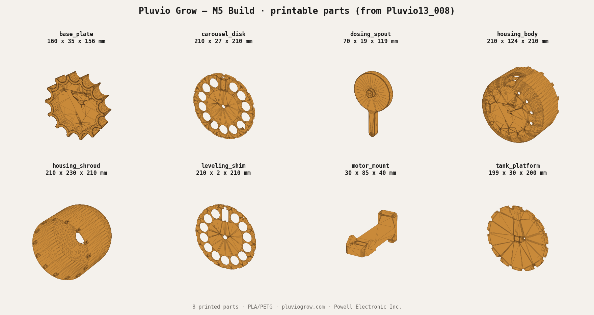

# 3D-Printed Parts — Pluvio Grow M5

Eight printed parts, extracted directly from the authoritative CAD assembly
**`../step/pluvio_m5_assembly.STEP`** (the confirmed M5 build). Print in PLA or PETG,
0.2 mm layers, 3–4 walls, 20–30 % infill. Most parts print flat with no
supports; orient the dome/shroud open-side-down.

| File | Part | Approx. size (mm) |
|---|---|---|
| `carousel_disk.stl` | 13-position metering disk | 210 × 210 × 27 |
| `housing_body.stl` | Main lower housing | 211 × 211 × 125 |
| `housing_shroud.stl` | Top cover / shroud | 211 × 211 × 231 |
| `base_plate.stl` | Base plate | 161 × 157 × 36 |
| `tank_platform.stl` | Reservoir platform | 200 × 200 × 30 |
| `dosing_spout.stl` | Dosing spout | 71 × 119 × 20 |
| `motor_mount.stl` | Motor mount | 30 × 40 × 85 |
| `leveling_shim.stl` | Leveling shim | 210 × 210 × 2 |



## Reproducing these from CAD

These STLs are generated from `../step/pluvio_m5_assembly.STEP` so the STEP file stays
the single source of truth. To regenerate:

```
pip install cadquery          # bundles OpenCASCADE / OCP
python extract_stl.py         # reads ../step/pluvio_m5_assembly.STEP, writes *.stl here
```

`extract_stl.py` reads the named solids out of the STEP assembly, meshes them,
and writes binary STLs under the builder-friendly names above. The CAD→file name
map lives in the `PARTS` dict at the top of the script — edit it if the set of
printed parts changes.

The full assembly (`../step/pluvio_m5_assembly.STEP`) is included so you can see how
the parts fit together before printing.
